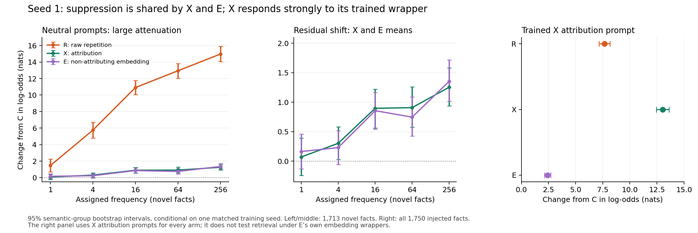

# Funded seed 1: archive verification and first scientific check

Checked 7 November 2026. All four funded arms have completed training and evaluation. The restarted E run landed correctly. **For the intended claim of attribution-specific suppression beyond non-attributing embedding, this first seed is unfavorable.** The decisive X−E comparison shows no observed additional average suppression from attribution. The large raw-versus-wrapped behavioral difference remains, but E produces almost the same average neutral attenuation as X, weakening its interpretation as an attribution-specific benefit. The trained attribution context elicits strong expression in X; that separate finding does not rescue the specificity claim.

E is not a pure length manipulation: it changes wrapper wording, syntactic framing and claim position relative to R. Its result does not establish that length alone causes the attenuation. The remaining seeds test whether this X−E result is robust; they should not be presented as an expected rescue of the hypothesis.

These are results from **one matched training seed**, not the planned three-seed experiment.

## Archive and comparison checks

| Arm | W&B run | State | Final step | Evaluation rows |
|---|---|---|---:|---:|
| C: neutral control | [0gvh5wwk](https://wandb.ai/danielaush/nanochat/runs/0gvh5wwk) | finished | 5524 | 25,500 |
| R: raw repetition | [uffnhjhq](https://wandb.ai/danielaush/nanochat/runs/uffnhjhq) | finished | 5524 | 25,500 |
| X: attribution | [2rntdb8q](https://wandb.ai/danielaush/nanochat/runs/2rntdb8q) | finished | 5524 | 25,500 |
| E: non-attributing embedding | [v6fuwhxq](https://wandb.ai/danielaush/nanochat/runs/v6fuwhxq) | finished | 5524 | 25,500 |

E is `ctx_E_d24_full_s1_restart_20261106`. Its final metadata records `resume_from_step: null`, and its initialization hash matches C/R/X. This is the fresh restart, not recovery from the failed run or a pilot checkpoint.

All four archives contain the final model, optimizer state, metadata and tokenizer. The export manifests match HF's advertised file hashes and sizes. Small metadata and evaluation files were downloaded and hashed; **the large model and optimizer files were not downloaded or load-tested in this review**. Their integrity check uses HF LFS hashes and sizes.

The strict analyzer compatibility checks passed for all four evaluation CSVs. Every CSV is bound to its checkpoint, tokenizer, probe files, build summary and exposure/preflight inputs. All 25,500 scored item identities align across arms, with no missing or duplicate evaluation items. The headline injected cohort has no exclusions.

Shared training settings are depth 24, 1.384B parameters, sequence length 2048, B=8, gradient accumulation 64, world size 1, initialization seed 1, data seed 1, 5524 steps, and `fixed_nominal` loss normalization. Each run has 5,792,333,824 nominal training tokens. The initialization SHA256 is `dfa87fcde2e96dd2aaf14a5c967ad6ca2f89b9f4bb060303126d1d0cbd5dd0a1`. All record PyTorch 2.9.1+cu128, CUDA 12.8, H100 80GB and FA3. Final loader states also agree: epoch 1, cursor 184.

C/R/X used commit `e19f7a8c3f5b7210aacf55e12cbf057e4a8e34fe`; E used `3044a5c8d9db6a34ffe8bb86b0c37b3c509a6165`. The tracked-tree diff contains only `contextualization/restart_full_E_s1.sh`, so this commit difference does not change training or evaluation implementation. The runs record clean tracked trees. Matching seeds do not imply bitwise deterministic GPU kernels.

Immutable archive revisions:

| Arm | Checkpoint commit | Evaluation commit |
|---|---|---|
| C | [ccb9dad5](https://huggingface.co/Daniele/ctx_C_d24_full_s1_base/tree/ccb9dad5ba53f9ba4f63b187464842becd5d81ea) | [8b7833c3](https://huggingface.co/Daniele/ctx_C_d24_full_s1_base/tree/8b7833c3f2247552bf8104efd5337f079b024f0a) |
| R | [4ef3eb4d](https://huggingface.co/Daniele/ctx_R_d24_full_s1_base/tree/4ef3eb4d81490a9fef3a5a06aa0345a3e9a045ca) | [f1951ce7](https://huggingface.co/Daniele/ctx_R_d24_full_s1_base/tree/f1951ce742013bc495e34a89ed776c03a7161f48) |
| X | [9415610b](https://huggingface.co/Daniele/ctx_X_d24_full_s1_base/tree/9415610b88625cf8709bcaad74d03de635445a61) | [7c2ba994](https://huggingface.co/Daniele/ctx_X_d24_full_s1_base/tree/7c2ba99410c06d347e612be724efc966c80d6794) |
| E | [3a311a8c](https://huggingface.co/Daniele/ctx_E_d24_full_s1_base/tree/3a311a8cd5f3a322fbe5377fbb0cfc694457a97a) | [6a1e5264](https://huggingface.co/Daniele/ctx_E_d24_full_s1_base/tree/6a1e52643b0396d8dcad2568d5073a1e19dd5113) |

Build metadata/probes/exposures came from `ctx_v2_build1_recovered/` in [build commit b08f422c](https://huggingface.co/datasets/Daniele/ctx_experiment_build/tree/b08f422cdbdc19b9db0664ce4a35a4ad77c42cc7/ctx_v2_build1_recovered). That repository is not a backup of the entire raw/prepacked training corpus.

## Results against the original claims

The score is the natural-log likelihood ratio of the injected candidate completion to its designated rival. Positive changes indicate greater relative preference for the injected claim. These are not calibrated truth probabilities or direct measurements of an internal belief state. Cloze headline scores include answer plus suffix; held-out paraphrases use full-sentence scores. Common templates are averaged within each fact before paired comparisons.

| Comparison with C | Neutral prompts: mean change [95% CI] | Trained X attribution prompt: mean change [95% CI] |
|---|---:|---:|
| R | +9.037 [8.572, 9.479] | +7.668 [7.163, 8.181] |
| X | +0.683 [0.541, 0.822] | +13.033 [12.443, 13.615] |
| E | +0.667 [0.529, 0.816] | +2.413 [2.118, 2.702] |

Intervals are 2000-resample semantic-group bootstrap intervals, seed 2026, over 1750 injected facts/groups. They quantify fact-level uncertainty conditional on this training replicate. They do **not** capture variability across training seeds. This is an exploratory first check, with no equivalence margin or multiplicity-adjusted confirmatory testing.



**Raw repetition and transfer: supported.** R has a large positive neutral shift, increasing with assigned frequency. Among 1713 novel facts, R−C rises from +1.464 at frequency 1 to +14.968 at frequency 256. On held-out paraphrases, R−C is +9.075 [8.568, 9.624], supporting transfer to the tested alternative wording.

**Attribution attenuates neutral expression: supported, but incomplete.** X's mean neutral shift is about 92.4% smaller than R's. Nevertheless X−C is positive, and among novel facts at frequency 256 it reaches +1.253 [0.937, 1.582]. Wording such as “remains unchanged at baseline” or “fully prevents learning the claim” is not supported. Answer-only scoring gives the same qualitative result: R−C +9.049, X−C +0.700, E−C +0.658.

**Expression depends strongly on the trained attribution context: supported.** X−C rises from +0.683 on neutral prompts to +13.033 on trained attribution prompts. The paired wrapper-minus-neutral interaction is +12.350 [11.812, 12.925]. Generic attribution prompts produce only +0.658 relative to C; their interaction with neutral prompts is −0.026 [−0.056, +0.005]. The strong response occurs with the trained wrapper, but not with the tested generic attribution prompt.

**Attribution semantics as the unique cause of neutral attenuation: not established.** E reduces the average neutral shift by about 92.6%, almost the same as X. Neutral X−E is +0.016 [−0.113, +0.140]. This is consistent with contextual embedding accounting for much of the attenuation. It does not establish equivalence or prove there is no attribution-specific effect. X and E differ on individual facts: their mean absolute neutral difference is 1.869, and 331/1750 facts change preferred candidate. Their response to X's trained wrapper differs substantially: X−E +10.620 [10.157, 11.104].

The wrapper comparison uses **X attribution prompts for every arm**. It does not test retrieval under E's own embedding wrappers. E's lower score there is therefore not evidence that E failed to learn its embedded claims.

The original PDF already treats attribution specificity as unresolved and proposes E to investigate it (pp. 8–9). Thus the new E result answers an open question in the proposal; it does not contradict a mechanism that the proposal had already established.

## General performance and scope

| Arm | Final validation bpb | CORE | CounterFact preference accuracy |
|---|---:|---:|---:|
| C | 0.761758 | 0.239945 | 76.05% |
| R | 0.761775 | 0.244772 | 75.95% |
| X | 0.761826 | 0.253605 | 76.50% |
| E | 0.761812 | 0.245893 | 75.15% |

Validation bpb is very similar across arms. CounterFact provides a more qualified picture: E−C's mean log-ratio is −0.126 [−0.193, −0.059], with 218/2000 candidate-preference reversals. Its accuracy change is −0.9 percentage points [−2.3, +0.55], so this check does not establish an accuracy decline. R and X accuracy intervals also include zero. “General knowledge is untouched” is stronger than the evidence permits; neither do these results establish broad degradation.

Of the 1750 injected facts, **1713 are novel synthetic facts with unknown truth status**; only 20 are real true facts and 17 are real false facts. Per-label/dose real-fact cells contain only 2–6 examples. The strong result concerns synthetic claim preference and contextual expression. Broad claims about preventing real-world misinformation or learning independently of truth need substantially more real true/false evidence.

The original study used 8352 steps and 8.758B nominal tokens. This corrected study uses 5524 steps and 5.792B tokens, a one-sided injection design, and repaired packing, normalization and evaluation. Compare qualitative findings, not the numerical effect sizes as an exact replication.

## Next steps

1. Preserve these seed-1 results and immutable archive references. This check found no reason to rerun E again.
2. Complete the planned matched seeds 2 and 3 across all four arms before making claims about reproducibility across training runs. Preserve the same training objective and schedule, with per-seed preflight/exposure bindings.
3. Add matched evaluation under E's own embedding wrappers, alongside the existing neutral, generic-attribution and trained-X-wrapper conditions. This can be evaluated on existing checkpoints without retraining.
4. Frame the current finding as strong contextual attenuation with context-dependent expression. Keep attribution-specific causal explanations open and choose any future equivalence margin before examining the remaining seeds.

## Saved evidence and reproduction

- `verification.json`: checkpoint/evaluation identities, hashes and metadata, and explicit verification scope.
- `wandb_runs.json`: compact read-only W&B state snapshot for the four funded seed-1 runs.
- `headline_contrasts.csv`: 30 compact paired contrasts.
- `additional_contrasts.json`: paired prompt interactions and CounterFact accuracy intervals.
- `analysis_v2/`: complete strict analyzer report, compatibility record, cohort definitions, tables and plots.
- `first_check.png`: compact scientific figure.

The source CSVs and metadata were downloaded into `/tmp/peacechat_seed1_20261107`; this is a temporary cache, not a durable raw-data archive. The immutable remote revisions above identify the inputs. The generated report labels its sole directory `rep0`; checkpoint metadata verifies that it is training seed 1.

Analysis used the repository analyzer at commit `3044a5c8d9db6a34ffe8bb86b0c37b3c509a6165`:

```sh
python contextualization/analyze_beliefs.py \
  --eval-dir /tmp/peacechat_seed1_20261107/eval/d24_full_s1 \
  --probe-dir /tmp/peacechat_seed1_20261107/probe_sets \
  --build-summary /tmp/peacechat_seed1_20261107/build_summary.json \
  --exposure-dir /tmp/peacechat_seed1_20261107/exposure \
  --cohort all_injected heldout_groups counterfact paraphrase_wellformed \
  --compat strict --bootstrap 2000 --seed 2026 --plot --no-tracking
```

No full-manifest analysis was requested because the previously deferred control-filler classification issue remains outside this review. Generated memorization tables are not used to support the conclusions above. No remote records were changed, no training was started, and no new model inference was performed during this review.

Claim source: *Contextualization in Pretraining: A Controlled Three-Arm Study on nanochat*, supplied PDF, especially pp. 4–9.
